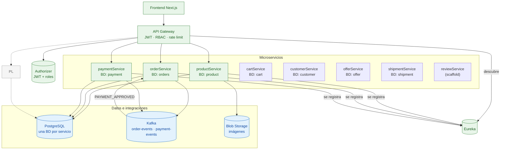

# LaTiendita

Tienda online distribuida: frontend **Next.js**, microservicios **Spring Boot**, descubrimiento con **Eureka**, un **API Gateway** como único punto de entrada y **Authorizer** como proveedor de identidad. Este README describe la arquitectura objetivo, qué piezas ya están implementadas y cómo levantar el entorno local.

> Los contratos detallados de cada servicio están en [`docs/microservicios/`](docs/microservicios/). El wireframe de diseño está en `docs/OpenPencil/LaTiendita.fig`.

## Arquitectura objetivo

Vista simplificada: **verde** = implementado, **gris** = scaffold, **azul** = infraestructura. Las líneas punteadas marcan componentes aún no implementados. Puertos e integraciones externas están en la tabla siguiente.



### Componentes

| Capa | Componente | Estado | Persistencia / responsabilidad |
|---|---|---|---|
| Cliente | `frontend/` (Next.js, :3000) | Implementado | Modo mock por defecto (`NEXT_PUBLIC_USE_MOCKS=true`); consume `/api/**` del gateway |
| Borde | `services/gateway/` (:8081) | Implementado | Valida JWT HS256 e issuer de Authorizer, aplica roles `admin`/`cliente`, CORS, rate limit, `X-Correlation-Id` e inyecta `X-User-Id`, `X-User-Email`, `X-User-Roles` |
| Identidad | Authorizer 2.4.4 (:8080) | Implementado | Usuarios, roles y JWT; SQLite persistido en `runtime/docker/authorizer/data`. No se registra en Eureka |
| Registro | `services/eureka-server/` (:8761) | Implementado | Descubrimiento de servicios; el gateway enruta con `lb://productService`, `lb://orderService`, `lb://paymentService`, `lb://cartService`, `lb://customerService`, `lb://offerService`, `lb://shipmentService` |
| Catálogo | `services/product-service/` | Implementado | PostgreSQL `product`; imágenes en Azure Blob Storage (container `productos`, Azurite en local) |
| Pedidos | `services/order-service/` | Implementado | PostgreSQL `orders`; publica `order-events` con outbox transaccional y consume `payment-events` |
| Pagos | `services/payment-service/` | Implementado | PostgreSQL `payment`; publica `payment-events` por outbox e integra Mercado Pago mediante webhook firmado |
| Envíos | `services/shipment-service/` | Implementado | PostgreSQL `shipment`; tarifa plana, `delivery_addresses` como fuente única de direcciones, outbox `shipment-events` y consumo de `payment-events`/`order-events` |
| Carrito | `services/cart-service/` | Implementado | PostgreSQL `cart`; snapshot de precio desde `product-service` y consumo de `product-events` |
| Clientes | `services/customer-service/` | Implementado | PostgreSQL `customer`; alta idempotente por `X-User-Id`, outbox `customer-events` y consumo de `user-events`. Sin direcciones (son de envíos) |
| Ofertas | `services/offer-service/` | Implementado | PostgreSQL `offer`; evaluación de promociones, outbox `promotion-events` y consumo de `order-events` |
| Reseñas | `services/review-service/` | Implementado | PostgreSQL `review`; outbox `review-events` y consumo de `order-events` |
| Mensajería | Kafka (:9092) | Implementado | `order-events`, `payment-events`, `shipment-events`, `customer-events` y `promotion-events` vía outbox transaccional; el outbox retiene eventos si el broker no responde. `order-service` consume `SHIPMENT_DISPATCHED` (`PAID` → `SHIPPED`) |
| Objetos | Azure Blob Storage / Azurite (:10000) | Implementado en catálogo | `product-service` guarda la clave del blob en `image_url` y la resuelve en `GET /api/products/{id}/image` |
| Observabilidad | Actuator + Prometheus + OTLP | Implementado | `/actuator/health`, `/actuator/prometheus`, trazas OTLP y logs estructurados |

### Flujos clave

1. **Autenticación:** el frontend llama a `/api/auth/**`; el gateway reescribe hacia Authorizer (`/v1/**`), valida el JWT (firma + issuer) y propaga la identidad por headers. Los servicios confían en esos headers; no validan el token por sí mismos.
2. **Catálogo:** `GET /api/products/**` y `/api/categories/**` son públicos y se resuelven vía Eureka. Las escrituras requieren rol `admin` y se deciden en el gateway.
3. **Checkout y pago:** `POST /api/orders` persiste el pedido y escribe un evento en el outbox; el relay lo publica en `order-events`. `payment-service` recibe el webhook de Mercado Pago, actualiza su base y publica `PAYMENT_APPROVED` en `payment-events`; `order-service` lo consume para avanzar el pedido a pagado.
4. **Imágenes:** el alta de productos guarda una clave de blob (no una URL absoluta) y el endpoint de imagen redirige URLs externas o hace proxy de los bytes del storage.

## Estructura del repositorio

```text
LaTiendita/
├── docs/
│   ├── microservicios/       # responsabilidades, APIs, BDD y eventos por servicio
│   ├── OpenPencil/           # wireframe de la tienda y del panel de administración
│   ├── design-system/        # tokens de diseño
│   └── IA-SESSIONS/          # decisiones de arquitectura y herramientas
├── frontend/                 # Next.js del storefront
├── services/
│   ├── Dockerfile.spring     # imagen compartida de los 10 módulos Spring Boot
│   ├── gateway/              # API Gateway (Spring Cloud Gateway)
│   ├── eureka-server/        # service registry
│   ├── product-service/
│   ├── order-service/
│   ├── payment-service/
│   ├── cart-service/         # Spring Boot + PostgreSQL + Kafka consumer
│   ├── customer-service/     # Spring Boot + PostgreSQL + outbox/Kafka
│   ├── offer-service/        # Spring Boot + PostgreSQL + outbox/Kafka
│   ├── review-service/       # scaffold
│   └── shipment-service/     # Spring Boot + PostgreSQL + outbox/Kafka
├── runtime/
│   ├── docker/               # compose, ngrok, PostgreSQL init y .env.example
│   └── floci-az/             # emulador alternativo (fuera del runtime actual)
└── odd/tasks/               # tareas de implementación del wireframe
```

## Arranque local

El backend completo corre en Docker. El frontend Next.js se ejecuta **fuera** de Docker, en el host, y se publica con el mismo túnel ngrok.

### 1. Configurar y levantar

```powershell
Copy-Item runtime/docker/.env.example runtime/docker/.env
# Completar POSTGRES_PASSWORD, AUTHORIZER_CLIENT_SECRET, AUTHORIZER_ADMIN_SECRET,
# AUTHORIZER_JWT_SECRET y AUTHORIZER_ENCRYPTION_KEY.
docker compose -f runtime/docker/compose.yaml up -d --build
docker compose -f runtime/docker/compose.yaml ps
```

`--build` solo hace falta la primera vez o después de cambiar un `pom.xml`. Las diez imágenes Spring Boot salen de un único `services/Dockerfile.spring` parametrizado por `MODULE_PATH`: la capa de dependencias Maven se descarga una sola vez y se reutiliza entre módulos mediante un caché mount de BuildKit.

### 2. Qué incluye el compose

| Servicio | Imagen / build | Red Docker | Host |
|---|---|---|---|
| `postgres` | `postgres:17.12-alpine3.24` | `postgres:5432` | `127.0.0.1:5432` |
| `kafka` | `apache/kafka:4.3.2` (KRaft, sin ZooKeeper) | `kafka:9092` | no publicado |
| `azurite` | `mcr.microsoft.com/azure-storage/azurite:3.38.0` | `azurite:10000` | `127.0.0.1:10000` |
| `authorizer` | `quay.io/authorizer/authorizer:2.4.4` | `authorizer:8080` | `127.0.0.1:8080` |
| `eureka-server` | módulo local | `eureka-server:8761` | `127.0.0.1:8761` |
| `gateway` | módulo local | `gateway:8081` | `127.0.0.1:8081` |
| 8 microservicios | módulos locales | `:8080` (sin publicar) | no publicado |
| `ngrok` | `ngrok/ngrok:3.39.13-alpine` | `host.docker.internal:3000`, `gateway:8081` | `127.0.0.1:4040` |

PostgreSQL corre como un único cluster ligero con **una base por microservicio**: `product`, `orders`, `payment`, `shipment`, `customer`, `cart`, `offer` y `review`. El script `runtime/docker/postgres/init/01-databases.sh` las crea en el volumen inicial. Authorizer mantiene su SQLite en `runtime/docker/authorizer/data/`.

Kafka crea los topics automáticamente desde los servicios: `order-events`, `payment-events`, `shipment-events`, `product-events`, `customer-events`, `user-events`, `review-events` y `promotion-events`. No se publica en el host porque todos los consumidores viven dentro de la red Docker; para inspeccionarlo, use `docker compose exec kafka /opt/kafka/bin/kafka-topics.sh --bootstrap-server localhost:9092 --list`.

Azurite expone solo el servicio de blobs, que es lo que usa `product-service` (container `productos`). La clave de desarrollo es pública y está en `.env.example`. `runtime/floci-az` queda como alternativa no utilizada por este runtime.

### 3. Frontend (fuera de Docker)

```powershell
Set-Location frontend
npm install
$env:NEXT_PUBLIC_USE_MOCKS = 'false'
$env:NEXT_PUBLIC_API_URL = 'http://localhost:8081'
npm run dev          # http://localhost:3000
```

Para una demo pública, `NEXT_PUBLIC_API_URL` debe apuntar a la **URL pública del gateway** (no a `localhost`: el navegador del cliente resolvería `localhost` en su propia máquina). Las variables `NEXT_PUBLIC_*` se leen al iniciar Next.js, así que reinicie el frontend después de cambiarlas.

### 4. Exposición pública automática con ngrok

El servicio `ngrok` arranca con el compose y crea dos endpoints HTTP:

- `frontend` → `host.docker.internal:3000` (el Next.js del host).
- `gateway` → `gateway:8081` (para `POST /api/webhooks/mercado-pago` y para mostrar el sistema a un cliente).

Configuración:

```powershell
# En runtime/docker/.env
NGROK_AUTHTOKEN=tu_token
# Opcional, recomendado para webhooks y demos estables:
NGROK_FRONTEND_DOMAIN=tu-frontend.ngrok.app
NGROK_GATEWAY_DOMAIN=tu-api.ngrok.app
```

Para ver las URLs asignadas:

```powershell
docker compose -f runtime/docker/compose.yaml logs -f ngrok
# o, en segundo plano: curl http://localhost:4040/api/tunnels
```

Sin `NGROK_AUTHTOKEN`, el contenedor queda inactivo (`sleep infinity`) y el resto del stack funciona igual. Sin dominios reservados, ngrok genera una URL nueva en cada reinicio: actualice `CORS_ALLOWED_ORIGINS`, `NEXT_PUBLIC_API_URL` y `MERCADO_PAGO_NOTIFICATION_URL` cuando eso ocurra. Con dominios reservados esos valores quedan fijos. El webhook de Mercado Pago debe registrarse como `<URL_PUBLICA_DEL_GATEWAY>/api/webhooks/mercado-pago`.

### 5. Verificación

- [ ] `docker compose -f runtime/docker/compose.yaml config --quiet` valida el stack.
- [ ] `docker compose -f runtime/docker/compose.yaml ps` muestra todos los servicios `healthy` (salvo `ngrok` si no hay token).
- [ ] `http://localhost:8761` muestra los servicios registrados.
- [ ] `curl http://localhost:8081/actuator/health` responde `UP`.
- [ ] `curl http://localhost:8081/api/products` devuelve el catálogo.
- [ ] `docker compose exec postgres psql -U tienda -d latiendita -c '\l'` lista las ocho bases.
- [ ] `curl http://localhost:4040/api/tunnels` lista los dos endpoints cuando hay token.
- [ ] `npm run lint` y `npm run build` pasan en `frontend/`.

## Estado actual y próximos pasos

El runtime local incluye Authorizer, PostgreSQL con una base por servicio, Kafka KRaft, Azurite, Eureka, gateway, los ocho microservicios de negocio y el túnel público ngrok. El frontend permanece fuera de Docker y se publica desde el host. Pendiente fuera de este alcance: el Terraform de `floci-az`, la observabilidad con un colector OTLP y la sustitución de ngrok por un ingress en producción.

Nota de verificación: los tests de integración usan Testcontainers y requieren Docker en ejecución. La validación local de esta entrega se limitó a compilación y tests unitarios Mockito; los tests `@SpringBootTest` se ejecutan en CI con Docker disponible.

Para profundizar, empezar por [`docs/microservicios/Template.md`](docs/microservicios/Template.md) y los contratos de cada servicio.