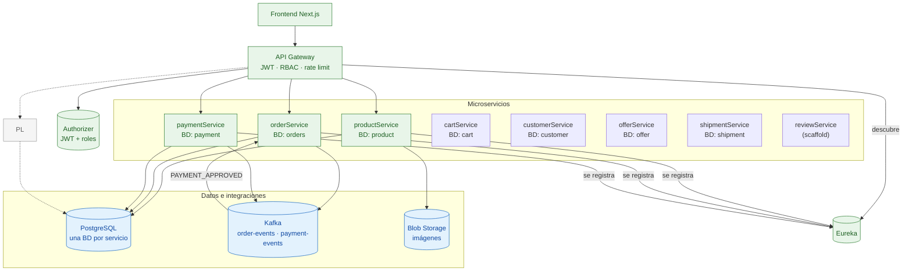

# LaTiendita

Tienda online distribuida: frontend **Next.js**, microservicios **Spring Boot**, descubrimiento con **Eureka**, un **API Gateway** como único punto de entrada y **Authorizer** como proveedor de identidad. Este README describe la arquitectura objetivo, qué piezas ya están implementadas y cómo levantar el entorno local.

> Los contratos detallados de cada servicio están en [`docs/microservicios/`](docs/microservicios/). El wireframe de diseño está en `docs/OpenPencil/LaTiendita.fig`.

## Arquitectura objetivo

Vista simplificada: **verde** = implementado, **gris** = scaffold, **azul** = infraestructura. Las líneas punteadas marcan componentes aún no implementados. Puertos e integraciones externas están en la tabla siguiente.



### Componentes

| Capa | Componente | Estado | Persistencia / responsabilidad |
|---|---|---|---|
| Cliente | `frontend/` (Next.js, :3000) | Implementado | Modo mock por defecto (`NEXT_PUBLIC_USE_MOCKS=true`); consume `/api/**` del gateway |
| Borde | `services/gateway/` (:8081) | Implementado | Valida JWT HS256 e issuer de Authorizer, aplica roles `admin`/`cliente`, CORS, rate limit, `X-Correlation-Id` e inyecta `X-User-Id`, `X-User-Email`, `X-User-Roles` |
| Identidad | Authorizer 2.4.4 (:8080) | Implementado | Usuarios, roles y JWT; SQLite persistido en `runtime/docker/authorizer/data`. No se registra en Eureka |
| Registro | `services/eureka-server/` (:8761) | Implementado | Descubrimiento de servicios; el gateway enruta con `lb://productService`, `lb://orderService`, `lb://paymentService`, `lb://cartService`, `lb://customerService`, `lb://offerService`, `lb://shipmentService` |
| Catálogo | `services/product-service/` | Implementado | PostgreSQL `product`; imágenes en Azure Blob Storage (container `productos`, Azurite en local) |
| Pedidos | `services/order-service/` | Implementado | PostgreSQL `orders`; publica `order-events` con outbox transaccional y consume `payment-events` |
| Pagos | `services/payment-service/` | Implementado | PostgreSQL `payment`; publica `payment-events` por outbox e integra Mercado Pago mediante webhook firmado |
| Envíos | `services/shipment-service/` | Implementado | PostgreSQL `shipment`; tarifa plana, `delivery_addresses` como fuente única de direcciones, outbox `shipment-events` y consumo de `payment-events`/`order-events` |
| Carrito | `services/cart-service/` | Implementado | PostgreSQL `cart`; snapshot de precio desde `product-service` y consumo de `product-events` |
| Clientes | `services/customer-service/` | Implementado | PostgreSQL `customer`; alta idempotente por `X-User-Id`, outbox `customer-events` y consumo de `user-events`. Sin direcciones (son de envíos) |
| Ofertas | `services/offer-service/` | Implementado | PostgreSQL `offer`; evaluación de promociones, outbox `promotion-events` y consumo de `order-events` |
| Reseñas | `services/review-service/` | Scaffold | Propuesto en `docs/microservicios/review-service.md` (fuera de alcance actual) |
| Mensajería | Kafka (:9092) | Implementado | `order-events`, `payment-events`, `shipment-events`, `customer-events` y `promotion-events` vía outbox transaccional; el outbox retiene eventos si el broker no responde. `order-service` consume `SHIPMENT_DISPATCHED` (`PAID` → `SHIPPED`) |
| Objetos | Azure Blob Storage / Azurite (:10000) | Implementado en catálogo | `product-service` guarda la clave del blob en `image_url` y la resuelve en `GET /api/products/{id}/image` |
| Observabilidad | Actuator + Prometheus + OTLP | Implementado | `/actuator/health`, `/actuator/prometheus`, trazas OTLP y logs estructurados |

### Flujos clave

1. **Autenticación:** el frontend llama a `/api/auth/**`; el gateway reescribe hacia Authorizer (`/v1/**`), valida el JWT (firma + issuer) y propaga la identidad por headers. Los servicios confían en esos headers; no validan el token por sí mismos.
2. **Catálogo:** `GET /api/products/**` y `/api/categories/**` son públicos y se resuelven vía Eureka. Las escrituras requieren rol `admin` y se deciden en el gateway.
3. **Checkout y pago:** `POST /api/orders` persiste el pedido y escribe un evento en el outbox; el relay lo publica en `order-events`. `payment-service` recibe el webhook de Mercado Pago, actualiza su base y publica `PAYMENT_APPROVED` en `payment-events`; `order-service` lo consume para avanzar el pedido a pagado.
4. **Imágenes:** el alta de productos guarda una clave de blob (no una URL absoluta) y el endpoint de imagen redirige URLs externas o hace proxy de los bytes del storage.

## Estructura del repositorio

```text
LaTiendita/
├── docs/
│   ├── microservicios/       # responsabilidades, APIs, BDD y eventos por servicio
│   ├── OpenPencil/           # wireframe de la tienda y del panel de administración
│   ├── design-system/        # tokens de diseño
│   └── IA-SESSIONS/          # decisiones de arquitectura y herramientas
├── frontend/                 # Next.js del storefront
├── services/
│   ├── gateway/              # API Gateway (Spring Cloud Gateway)
│   ├── eureka-server/        # service registry
│   ├── product-service/
│   ├── order-service/
│   ├── payment-service/
│   ├── cart-service/         # Spring Boot + PostgreSQL + Kafka consumer
│   ├── customer-service/     # Spring Boot + PostgreSQL + outbox/Kafka
│   ├── offer-service/        # Spring Boot + PostgreSQL + outbox/Kafka
│   ├── review-service/       # scaffold
│   └── shipment-service/     # Spring Boot + PostgreSQL + outbox/Kafka
├── runtime/
│   ├── docker/               # compose + .env.example de Authorizer
│   └── floci-az/             # emulador local de Azure + Terraform (aún vacío)
└── odd/tasks/               # tareas de implementación del wireframe
```

## Arranque local

### 1. Authorizer

```powershell
Copy-Item runtime/docker/.env.example runtime/docker/.env
# Completar AUTHORIZER_CLIENT_SECRET, AUTHORIZER_ADMIN_SECRET,
# AUTHORIZER_JWT_SECRET y AUTHORIZER_ENCRYPTION_KEY
docker compose -f runtime/docker/compose.yaml up -d
docker compose -f runtime/docker/compose.yaml ps   # esperar a STATUS: healthy
```

Authorizer escucha solo en `127.0.0.1:8080`. El gateway usa el mismo `AUTHORIZER_JWT_SECRET` como `JWT_SECRET` y `AUTHORIZER_URL` como `JWT_ISSUER`.

### 2. Infraestructura de datos

El repositorio **no incluye todavía** un compose para PostgreSQL, Kafka ni Azurite: use instancias locales propias o Testcontainers para las pruebas. Los valores por defecto son `localhost:5432`, `localhost:9092` y `http://localhost:10000/devstoreaccount1`.

Cada servicio requiere `SPRING_DATASOURCE_URL`, `SPRING_DATASOURCE_USERNAME` y `SPRING_DATASOURCE_PASSWORD`. El gateway requiere además `JWT_SECRET` y `JWT_ISSUER`; `product-service`, `AZURE_STORAGE_KEY` para habilitar el storage.

### 3. Backends

```powershell
# En cada servicio con código: eureka-server, gateway, product, order, payment
Set-Location services\product-service
.\mvnw spring-boot:run
```

Eureka arranca en `:8761`, el gateway en `:8081` y los servicios de negocio en `:8080` (use `SERVER_PORT` si los levanta en la misma máquina).

### 4. Frontend

```powershell
Set-Location frontend
npm install
npm run dev          # http://localhost:3000, modo mock activo
# NEXT_PUBLIC_USE_MOCKS=false y NEXT_PUBLIC_API_URL=http://localhost:8081 para usar el backend
```

### 5. Emulador de Azure (opcional)

```powershell
docker compose -f runtime/floci-az/compose.yaml up -d
.\runtime\floci-az\scripts\trust-cert.ps1   # una vez por máquina
```

`floci-az` expone `127.0.0.1:4577` y su consola en `http://localhost:4577/_floci/ui`. Requiere certificado de confianza porque el provider `azurerm` descubre la nube por HTTPS. El directorio `runtime/floci-az/terraform/` hoy solo contiene `.gitkeep`: la infraestructura como código de Container Apps y storage aún está pendiente.

## Verificación

- [ ] `docker compose -f runtime/docker/compose.yaml ps` muestra Authorizer en estado `healthy`.
- [ ] `http://localhost:8761` muestra los servicios registrados.
- [ ] `curl http://localhost:8081/actuator/health` responde `UP`.
- [ ] `curl http://localhost:8081/api/products` devuelve el catálogo.
- [ ] `.\mvnw verify` pasa en cada servicio con código.
- [ ] `npm run lint` y `npm run build` pasan en `frontend/`.

## Estado actual y próximos pasos

Implementado: gateway (con rutas para los siete servicios), Eureka, catálogo con object storage, pedidos, pagos, carrito, clientes, ofertas y envíos con outbox/Kafka, y frontend en modo mock. Pendiente: completar el scaffold de reseñas, el Terraform de `floci-az` y el compose local de PostgreSQL/Kafka/Azurite.

Nota de verificación: los tests de integración usan Testcontainers y requieren Docker en ejecución. La validación local de esta entrega se limitó a compilación y tests unitarios Mockito; los tests `@SpringBootTest` se ejecutan en CI con Docker disponible.

Para profundizar, empezar por [`docs/microservicios/Template.md`](docs/microservicios/Template.md) y los contratos de cada servicio.
